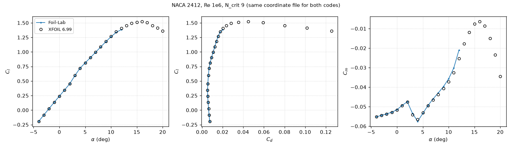
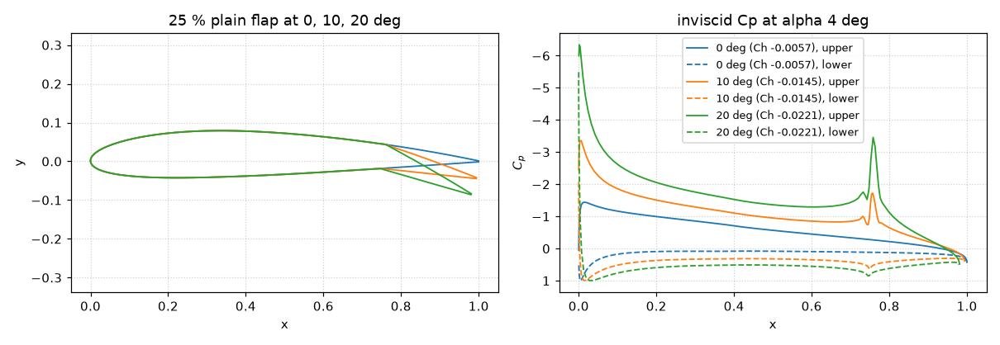
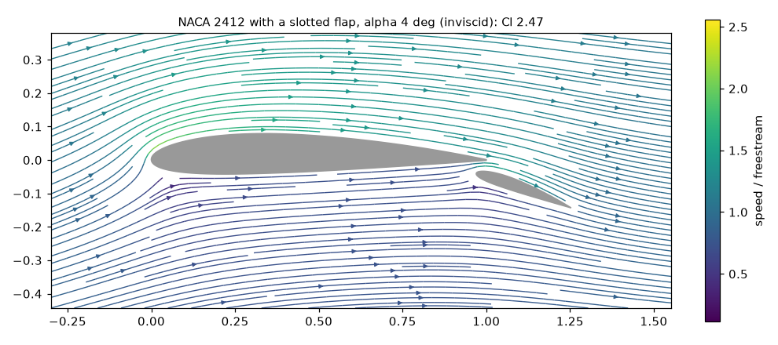

# Foil-Lab

A pip-installable 2D panel-method solver for single, flapped and multi-element airfoil sections,
with a coupled viscous-inviscid solver, and its accuracy against XFOIL published for every case.



## Install

```bash
pip install "foil-lab[pandas] @ git+https://github.com/PradeepkrishnaGM/foil-lab"
# or, in a clone:
pip install -e ".[all]"
```

Python 3.10 or newer (tested on 3.10, 3.12 and 3.14). Extras: `gui` (PySide6), `pandas`, `batch`
(Parquet and HDF5 output), `jax` (differentiable inviscid core), `notebook`.

## 30-second example

```python
import foil_lab as fl
from foil_lab import plot

af = fl.Airfoil.naca("2412")
res = fl.analyze(af, alpha=4.0, re=1e6)          # coupled viscous-inviscid solver
print(res.cl, res.cd, res.cm, res.converged)      # 0.72, 0.0069, -0.057, True

pol = fl.polar(af, range(-4, 11), re=1e6)
fig, axes = plot.polars(pol, labels=["NACA 2412, Re 1e6"])
fig.savefig("polar.png")

flapped = af.with_flap(hinge_x=0.75, deflection=10.0)
print(fl.analyze(flapped, 2.0).ch)                # hinge moment, trailing edge down positive
```

Command line:

```bash
foillab analyze --naca 2412 --alpha 4 --re 1e6
foillab polar --name e387 --start -4 --end 10 --re 3e5 --output e387.csv
foillab-gui                                       # the desktop GUI
```

More: `examples/tour.ipynb` (runs in under a minute on a CPU), `examples/slotted_flap.py`, and the
API reference in [docs/api.md](docs/api.md).

## What it does

- **Sections:** NACA 4- and 5-digit generators, coordinate files (Selig or Lednicer), any section of
  the UIUC Airfoil Coordinates Database by name (downloaded once into a local cache), arc-length
  repanelling, trailing-edge gap, thickness and camber scaling.
- **Inviscid analysis:** linear-strength vortex panels, one or several elements in any position.
- **Viscous analysis:** integral boundary layer and wake coupled to the panel method in one Newton
  system, e^n transition (N_crit) with optional forced trips; drag split into friction and pressure;
  a `converged` flag that is true only when the residual criteria were met.
- **Plain flaps:** smooth hinge geometry from -30 to +30 deg, hinge moment, flap polar sets with
  interpolation in deflection.

  

- **Several elements:** a boundary layer and wake on every element, forces per element and in total.

  

- **Corrections**, each applied once in a fixed order and listed in the result: ground effect (image
  method), simple sweep, Kármán-Tsien compressibility with the critical Mach number, finite aspect
  ratio (Helmbold's lift factor, induced drag, profile drag at the effective angle).
- **Data:** results to pandas, CSV, JSON and XFOIL-layout polar files; a SQLite polar database keyed by
  geometry hash, conditions and code version; a batch runner (serial or parallel processes); plot
  helpers that return the figure and axes.

## Validation

Every number is in [VALIDATION.md](VALIDATION.md), generated from the benchmark: Foil-Lab and XFOIL
6.99 read the same coordinate file, for NACA 0012, 2412, 4412, 23012, Clark Y and E387, at Re 5e4
to 6e6, -4 to 20 deg. Summary for the sections with an open trailing edge, inside the attached-flow
range, all sections pooled per Reynolds number:

| Re | converged | mean / max abs dCl | mean / max rel dCd | mean / max abs dCm |
|---|---|---|---|---|
| 1e5 | 100 % | 0.0062 / 0.028 | 3.0 % / 26 % | 0.0011 / 0.0040 |
| 1e6 | 100 % | 0.0020 / 0.016 | 1.7 % / 7.3 % | 0.0004 / 0.0032 |
| 6e6 | 96.4 % | 0.0026 / 0.024 | 1.6 % / 6.0 % | 0.0005 / 0.0045 |

The SPEC targets (converged >= 95 %; mean / max dCl 0.03 / 0.10; dCd 10 % / 30 %; dCm 0.01 / 0.03)
are met at every Reynolds number from 1e5 to 6e6. This is agreement with XFOIL, not with
experiment. Plain flaps meet the same targets up to 5 deg; 10 to 20 deg are reported without a claim.
Exact-solution tests (Kármán-Trefftz, Williams' two-element solution, the ground-effect mirror
problem, Blasius) run with the test suite.

## Limits

- Subsonic, attached or mildly separated flow. Not for transonic flow. Viscous results are Mach 0;
  the compressibility correction applies to inviscid results.
- Validated at Re from 1e5 to 6e6. Lower Reynolds numbers are reported in the benchmark but not
  validated.
- Maximum lift and post-stall behaviour are approximate.
- Plain flaps: validated up to 5 deg deflection (VALIDATION.md).
- Multi-element results exclude wake merging and slot separation, have no maximum-lift prediction,
  and have no viscous reference: they rest on consistency tests only.
- A closed (sharp) trailing edge is opened to 0.0005 c for viscous analysis by default (recorded in
  the result's corrections).

## Methods

The inviscid core follows Drela (1989); the viscous model follows the published formulation of
Drela & Giles (1987) and Drela (1989), with the closure set of Fidkowski ("A Coupled
Inviscid-Viscous Airfoil Analysis Solver, Revisited") as the default. All sources and their
verification status: [docs/methods.md](docs/methods.md). XFOIL is used only as an external program
for the benchmark; no XFOIL code is part of Foil-Lab ([THIRD_PARTY.md](THIRD_PARTY.md)).

## Development

```bash
pip install -e ".[all]"
python -m pytest tests/ -q -m "not slow"     # fast suite, under a minute
python -m pytest tests/ -q                   # everything (about 30 minutes)
python -m foil_lab.benchmark --help          # the XFOIL benchmark (needs xfoil and xvfb-run)
```

Version history: [CHANGELOG.md](CHANGELOG.md). Licence: MIT ([LICENSE](LICENSE)).
